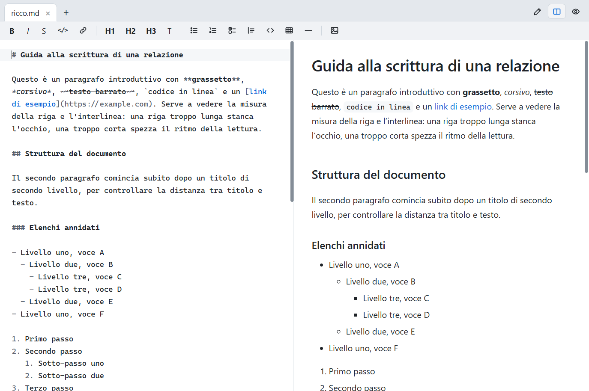
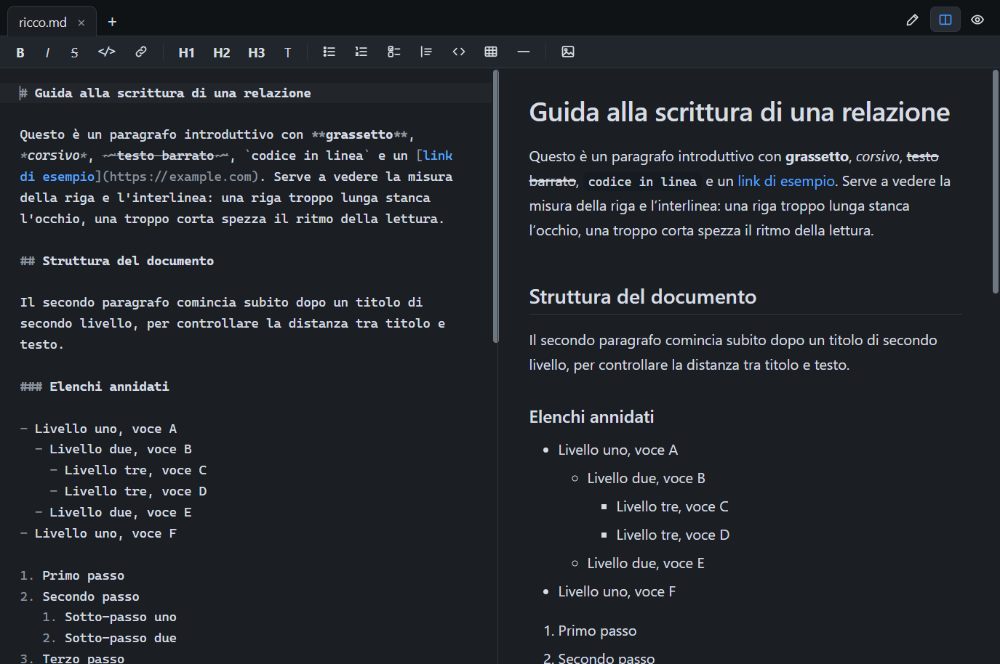

# Pagina

Editor e lettore Markdown per Windows.

Puoi scrivere nel sorgente oppure direttamente nell'anteprima. Tutto resta sul tuo computer: Pagina non invia nulla in rete.





## Cosa fa

- Apre più file in schede.
- Mostra l'editor e l'anteprima affiancati, oppure uno dei due da solo.
- Ti lascia modificare direttamente nell'anteprima, blocco per blocco.
- Gestisce le tabelle, anche nell'anteprima.
- Ha una barra di formattazione (grassetto, corsivo, titoli, elenchi, link, codice, tabelle, immagini).
- Salva le immagini incollate accanto al file Markdown.
- Ha un tema chiaro e uno scuro.
- Parla italiano e inglese.
- Lavora tutto in locale.

## Come compilarla

Servono:

- [Rust](https://www.rust-lang.org/tools/install)
- [Node.js](https://nodejs.org/)
- [pnpm](https://pnpm.io/)
- WebView2 (di solito è già presente in Windows 11)

Poi, dalla cartella del progetto:

```
pnpm install
pnpm tauri build
```

Per provarla senza creare l'installatore usa `pnpm tauri dev`.

## Test

```
pnpm test
```

Lancia i test sul codice (Vitest).

```
pnpm test:e2e
```

Lancia i test sull'app vera, con WebdriverIO. Servono `tauri-driver` (`cargo install tauri-driver --locked`) e `msedgedriver` della stessa versione di WebView2. Di solito `msedgedriver.exe` sta in `%USERPROFILE%\.local\msedgedriver\`; puoi indicare un altro percorso con la variabile `MSEDGEDRIVER`. Prima di lanciarli serve una build di debug (`pnpm tauri build --debug`).

## Licenza

Copyright (C) 2026 Diletta Falcone.

Pagina è software libero, distribuito con licenza [GNU Affero General Public License, versione 3 o successiva](LICENSE) (AGPL-3.0-or-later).
